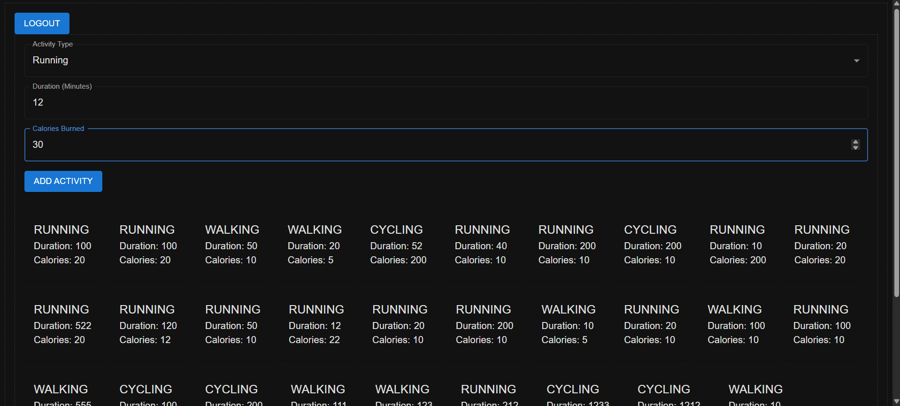
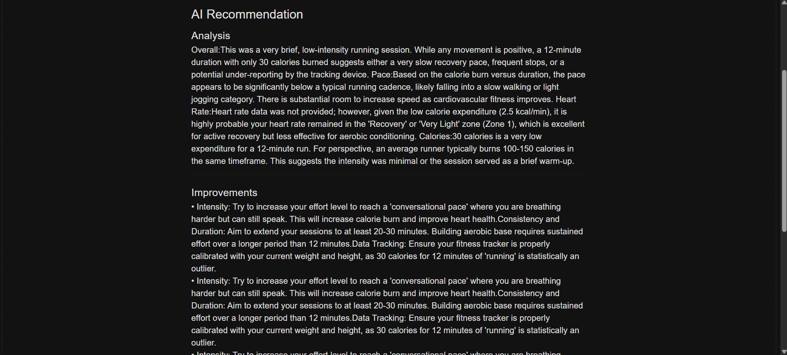
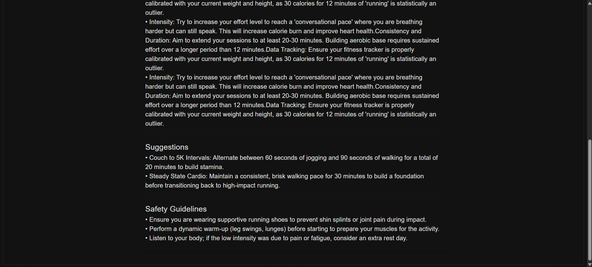

# 🤖 AI-Powered Fitness Application

> An AI-powered fitness application that uses Google Gemini AI to generate recommendations, suggestions, and improvement insights from user activity data.

---

## 📌 Brief One-Line Summary

**An AI-powered fitness application built with  microservices architecture , asynchronous communication using Apache Kafka, Keycloak authentication, Docker, and Google Gemini API integration.**

---

## 📖 Overview

The AI-Powered Fitness Application processes user fitness activity data and uses Google Gemini AI to generate recommendations, suggestions, and areas for improvement.

The application is organized into three services:

- **User Service** — handles user-related functionality.
- **Activity Service** — handles fitness activity data.
- **AI Service** — integrates with Google Gemini API to generate AI-powered insights.

Apache Kafka is used for asynchronous communication between services. Keycloak is used for authentication, and Docker is used to containerize the application components.

The generated AI output is processed into clean, structured, and readable data before being made available to the user.

---

## 🛠️ Tools and Technologies

| Technology                        | Purpose                                                                             |
| --------------------------------- | ----------------------------------------------------------------------------------- |
| Microservices Architecture        | Organizes the application into User Service, Activity Service, and AI Service       |
| Apache Kafka                      | Enables asynchronous communication between services                                 |
| Keycloak                          | User interface components                                                           |
| Docker                            | Containerizes application components                                                |
| Google Gemini API                 | Generates recommendations, suggestions, and improvement insights from activity data |

---


## 🏗️ System Architecture

The application is organized into three services that work together to process fitness activity data and provide AI-generated insights.

```text
                 ┌─────────────────────┐
                 │    User Service     │
                 └─────────────────────┘

                 ┌─────────────────────┐
                 │   Activity Service  │
                 └──────────┬──────────┘
                            │
                            │ Asynchronous
                            │ Communication
                            ▼
                 ┌─────────────────────┐
                 │   Apache Kafka      │
                 └──────────┬──────────┘
                            │
                            ▼
                 ┌─────────────────────┐
                 │      AI Service     │
                 └──────────┬──────────┘
                            │
                            ▼
                 ┌─────────────────────┐
                 │ Google Gemini API   │
                 └──────────┬──────────┘
                            │
                            ▼
                 ┌─────────────────────┐
                 │ Processed and Clean │
                 │ Fitness Insights    │
                 └──────────┬──────────┘
                            │
                            ▼
                 ┌─────────────────────┐
                 │        User         │
                 └─────────────────────┘

       Keycloak: Authentication
       Docker: Containerization
```

---

## ⚙️ Methods / Application Workflow

### Step 1: User Authentication

Keycloak is used to handle authentication for the application.

### Step 2: Fitness Activity Data

The Activity Service handles the user's fitness activity data.

### Step 3: Asynchronous Communication

Apache Kafka enables asynchronous communication between the application services.

### Step 4: AI Processing

The activity data is shared with the Google Gemini API through the AI Service.

### Step 5: Recommendation Generation

Google Gemini AI generates recommendations, suggestions, and improvement insights based on the activity data provided.

### Step 6: Response Processing

The generated response is processed into clean, structured, and readable data.

### Step 7: Insights Made Available to the User

The processed fitness recommendations and suggestions are made available to the user.

---

## ✨ Key Features

- **Three-Service Architecture:** User Service, Activity Service, and AI Service.
- **Asynchronous Communication:** Apache Kafka is used for communication between services.
- **Authentication:** Keycloak is used for user authentication.
- **AI-Powered Insights:** Google Gemini API generates recommendations, suggestions, and improvement insights from fitness activity data.
- **Clean AI Output:** Processed and formatted recommendations are made available to users.
- **Containerization:** Docker is used to containerize application components.

---

## 📸 Dashboard / Screenshots


### Activity Management

<p align="center">
  
</p>

### AI-Powered Fitness Recommendations

<p align="center">
  
</p>

<p align="center">
  
</p>
## 🖥️ Application Output

The application uses fitness activity data to generate AI-powered recommendations.

**Input:** User fitness activity data.

**AI Processing:** Activity data is shared with Google Gemini API.

**Output:** Clean, formatted recommendations, suggestions, and improvement insights made available to the user.

---

## 👨‍💻 Project Summary

This project combines microservices architecture, asynchronous communication, authentication, containerization, and Generative AI. It uses Apache Kafka for asynchronous communication, Keycloak for authentication, Docker for containerization, and Google Gemini API to generate fitness recommendations from activity data.

---

<p align="center">

Made with ❤️ using Apache Kafka, Keycloak, Docker, and Google Gemini AI.

</p>
